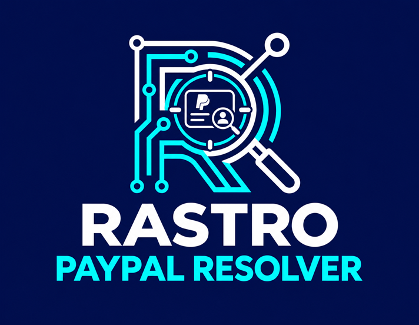

# RASTRO PayPal Resolver v0.4.0



Consola OSINT para navegador (Chrome, Edge, Brave, Opera) que resuelve **perfiles públicos de PayPal.Me** a partir de un username, un correo o un teléfono, y documenta cada actuación con **cadena de custodia** (hash SHA-256, registro con hora UTC, informe imprimible).

Forma parte de **RASTRO — Kit de Investigación de Fuentes Abiertas**, creado por **S3GAD3**.

> **Proyecto independiente.** No está afiliado, patrocinado ni aprobado por PayPal. PayPal y PayPal.Me son marcas de sus respectivos titulares.
>
> Puede descargar el archivo .zip para la instalación y uso de la extensión en el apartado releases: https://github.com/S3GAD3/rastro-paypal/releases/

## Qué obtiene y cómo

| Entrada | Sin cuenta PayPal | Con cuenta de trabajo |
|---|---|---|
| **Username** | Consulta HTTP directa a `paypal.com/paypalme/<alias>` y extracción de los datos que la propia página pública incrusta: nombre, nombre y apellidos, fotografía, localidad, país, verificación, tipo de cuenta, ID interno (payer/merchant), divisa. Prueba variantes del alias. | — |
| **Email** | Gravatar por hash SHA-256 (nombre, foto, localidad, cuentas vinculadas). Alias derivados del correo (`juan.perez88@…` → `juanperez88`, `juanperez`, `jperez`…) comprobados en PayPal.Me. Los alias que aporte Gravatar se encolan automáticamente. | Captura asistida del buscador de destinatarios. |
| **Teléfono** | Normalización E.164, formatos para búsqueda, pivotes (Google, WhatsApp, Telegram) y, opcionalmente, el número como alias PayPal.Me. | Captura asistida del buscador de destinatarios. |
| **Lote** | Hasta 25 identificadores mezclados; el tipo se detecta solo. | — |

Si PayPal responde con un reto de seguridad o sin datos embebidos, la herramienta **reintenta en una pestaña en segundo plano** y extrae el contenido ya renderizado. Si aparece un captcha, la pestaña se entrega al investigador para que lo resuelva; la herramienta no intenta eludirlo.

### Lo que no hace (deliberadamente)

PayPal no ofrece ninguna vía pública para saber a quién pertenece un correo o un teléfono. Las únicas formas de obtenerlo sin sesión pasarían por abusar de los formularios de registro, inicio de sesión o recuperación de contraseña, lo que vulnera las condiciones del servicio, puede bloquear la IP del organismo y compromete la validez de la prueba. Por eso esas resoluciones se hacen por pivotes (Gravatar, alias derivados) o mediante la **captura asistida** con una cuenta de trabajo.

## Uso

1. Pulsa el icono de RASTRO: se abre la consola en una pestaña completa.
2. Rellena **Expediente** e **Investigador/TIP** (aparecen en el informe).
3. Elige pestaña (Username / Email / Teléfono / Lote), introduce el dato y pulsa **Ejecutar resolución** (o `Ctrl+Enter`).
4. Revisa las **fichas**: sello POSITIVO / REVISIÓN / NEGATIVO / BLOQUEADO, confianza 0-100, campos con botón de copia, fotografía ampliable, pivotes de identidad y evidencia técnica.
5. Exporta: **Informe policial** (HTML imprimible/PDF con fotografías incrustadas y fichero `.sha256` adjunto), JSON, CSV (Excel) o TXT. Los ficheros se guardan en `Descargas/RASTRO-PayPal/<expediente>/`.

### Captura asistida (correo/teléfono con cuenta)

1. Panel 02 → **Abrir buscador PayPal**: el identificador se copia al portapapeles.
2. Pégalo en PayPal y espera a que aparezca el destinatario.
3. Vuelve a la consola → **Analizar pestaña**. Solo se usa lo visible en pantalla, nunca el estado interno de la página (que contiene datos de la propia cuenta del investigador).
4. **Captura pantalla** adjunta una imagen de la fuente, con su hash, a la ficha correspondiente. Si Chrome la deniega, pulsa el icono de RASTRO estando en esa pestaña y repite.

## Estados

- **POSITIVO**: se obtuvo nombre (o foto con alias coincidente).
- **REVISIÓN**: la página respondió, pero sin datos suficientes; compruébalo manualmente.
- **NEGATIVO**: PayPal indica que el perfil no existe o redirige fuera del alias. Formulación correcta: *sin perfil PayPal públicamente localizable mediante este identificador en el momento de la comprobación*.
- **BLOQUEADO**: reto de seguridad o límite de peticiones.

## Cadena de custodia

- SHA-256 del HTML/JSON de cada fuente, de cada fotografía y de cada captura de pantalla.
- Copia local de la fotografía (no depende de que la URL siga viva).
- Registro de actuaciones con hora UTC, incluido en el informe.
- Hash del informe en un fichero `.sha256` independiente.

## Instalación

1. `chrome://extensions` (o `edge://`, `brave://`, `opera://`).
2. Activa **Modo desarrollador** → **Cargar descomprimida** → selecciona esta carpeta.
3. Fija el icono en la barra.

## Permisos

| Permiso | Finalidad |
|---|---|
| `tabs`, `activeTab`, `scripting` | Abrir la consola, pestañas en segundo plano y extraer lo visible en PayPal. |
| `storage`, `unlimitedStorage` | Sesión actual e historial (hasta 30 sesiones) en el propio navegador. |
| `downloads` | Informes, exportaciones y fotografías. |
| Dominios PayPal / paypalobjects | Consultar PayPal.Me y copiar fotografías de perfil. |
| Gravatar | Consulta pública por hash del correo. |

No se solicita acceso a otros sitios web.

## Estructura

```text
assets/          Logotipo, emblema e iconos
background.js    Apertura/recuperación de la consola
console.html     Interfaz
console.css      Estilo (tema azul policial)
js/util.js       Utilidades, normalización, candidatos, limitador de ritmo
js/parser.js     Analizador de páginas PayPal.Me
js/resolvers.js  PayPal.Me (HTTP y pestaña), captura asistida, Gravatar, fotos, capturas
js/report.js     Informe policial, TXT, JSON, CSV
js/app.js        Controlador de la consola
```

## Uso responsable

Utilízala solo en investigaciones legítimas y autorizadas, respetando necesidad, proporcionalidad, minimización y corroboración (RGPD / LO 7/2021). No la uses para acoso, vigilancia no autorizada, campañas masivas ni acceso indebido a cuentas.

## Licencia

MIT — © S3GAD3.
